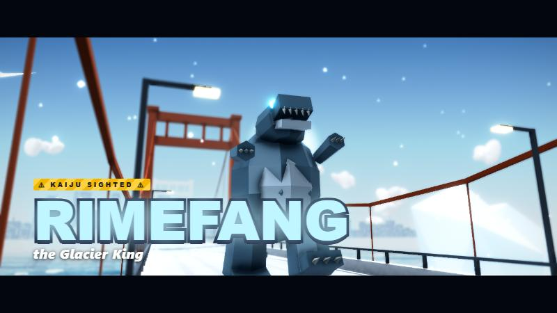
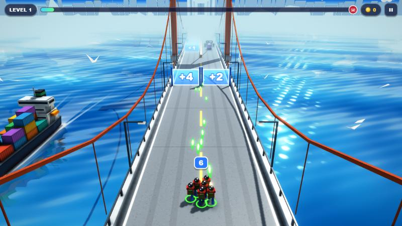
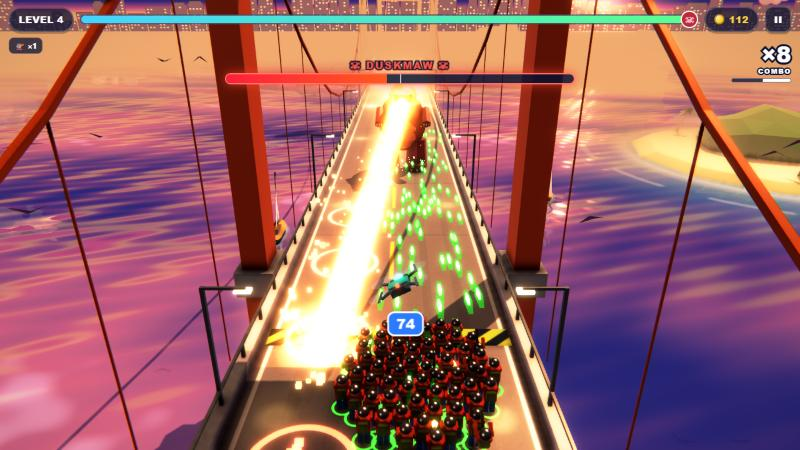
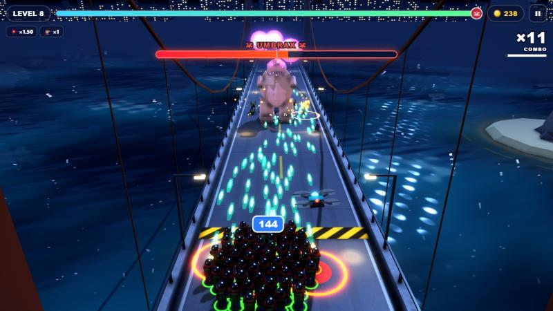
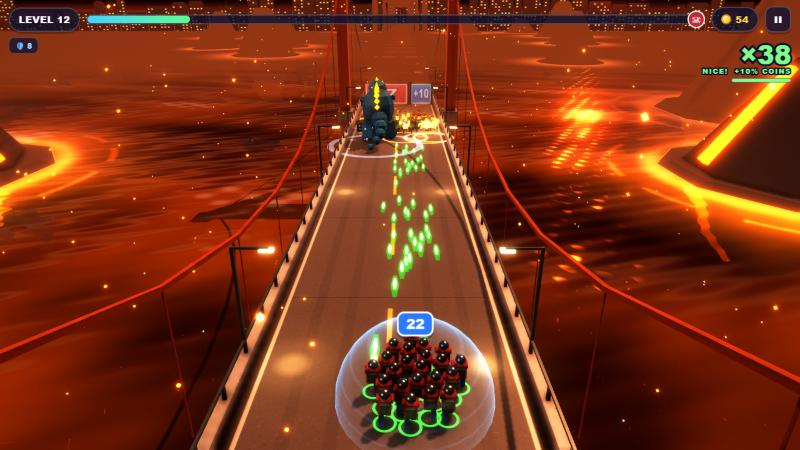
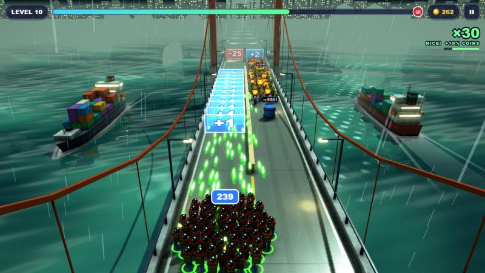
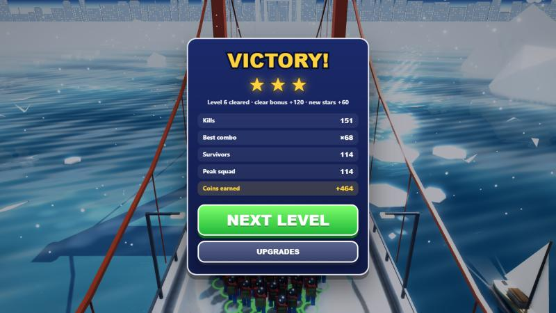

# Bridge Brigade

**Grow the squad. Hold the bridge. Slay the kaiju.**

A 3D crowd-runner that lives in a browser tab. Your squad runs up a suspension bridge and fires on
its own. All you do is steer: through the gates that grow it, away from the ones that shrink it,
and out of the way when the monster at the end of the bridge opens its mouth.

No install, no build step, no network, no asset files. Open it and play.



## Play

```sh
node serve.js
```

Then open <http://localhost:8765>.

Node is only there to serve the folder. Any static file server does the job, and there is nothing
to install: three.js is vendored in `js/vendor/`, so the game works offline.

Every tagged version is also on the [Releases page](https://github.com/zakariahere/bridge-brigade/releases)
as a zip you can unpack and run the same way.

### Controls

| | |
|---|---|
| **Mouse** | Move the cursor. The squad follows it. |
| **Touch** | Drag anywhere. |
| **Keyboard** | `A` / `D` or `←` / `→` to steer, `Esc` or `P` to pause |
| **Menu** | `Enter` or `Space` to play, `←` / `→` to pick a level |

## What's in it

- **Gates.** Blue ones grow the squad (`+8`, `×2`), red ones shrink it. They come in pairs, so you
  choose. Some start red and climb as you shoot them. From level 4, some pairs slide: the line
  between them moves, and the good gate keeps getting wider and narrower.
- **Barrels.** Shoot the number down to zero for what is inside: fire rate, damage, multi-shot,
  recruits, coins, a bomb, a gunship drone, a deep freeze, an energy shield, or a caged kaiju that
  fights on your side. Run into a barrel instead and it costs you part of the squad.
- **Hordes.** Walkers, runners, brutes, and bloaters. Bloaters explode when they die and take their
  neighbours with them, so one good shot can ripple through a whole crowd.
- **A boss on every bridge.** It breathes a beam down half the road, lobs fireballs that land where
  the circles are, sends waves of minions, and gets angry at half health.
- **Six biomes**, a new one every two levels, each with its own weather, sea, skyline and kaiju:
  Sunny Strait, Sunset Sound, Frostbite Bay, Midnight Crossing, Stormfront and Cinder Sea.
- **A sea that is really there.** It mirrors the bridge, the ships and the monster, and takes
  their shadows. Container ships and dinghies sail past, each with its own wake.
- **Combos, stars and upgrades.** Kill streaks pay bonus coins. Coins buy five permanent upgrades.
  Each level is rated one to three stars by how much of your squad survives, and any level you have
  unlocked can be replayed from the menu.

Levels are generated from a seed, so they never run out and level 12 is the same level 12 every time.
Progress is kept in the browser's local storage.

## Screenshots

| | |
|---|---|
|  |  |
| Sunny Strait. The ship is mirrored in the sea, and the bridge throws its shadow on the water. | The breath beam rakes one half of the bridge. Stand on the other half. |
|  |  |
| A fireball volley at night. Each red circle marks where one is about to land. | Cinder Sea: a freed kaiju charges the horde for you, a 38 kill combo, a shield dome over the squad. |
|  |  |
| Stormfront: rain on a wet road, and container ships passing on both sides with their lights on. | Three stars for bringing most of the squad home. |

## How it is built

Plain JavaScript and [three.js](https://threejs.org) r149, loaded with ordinary `<script>` tags.
There is no bundler and no dependency to install.

Nothing is loaded from disk except code. The soldiers, monsters and bridge are assembled from
boxes, spheres and cones. Textures are drawn onto canvases at start-up. Every sound, the music
included, is synthesised with WebAudio.

### How the picture gets its depth

Simple shapes only look solid if the light treats them as solid. Five things do that here:

- **Light from the side.** The sun stands ahead and well to the right, so the three faces of a box
  you can see are three different brightnesses. A cool fill light from the left keeps the shaded
  side from going flat.
- **Shadows on everything near the bridge**, the sea included. One shadow map covers some sixty
  units either side and slides along with the squad in whole-texel steps, so edges never shimmer.
- **Ambient occlusion.** The soft shade where a barrel meets the road or two containers touch is
  worked out from the depth of each pixel alone. No model had to change to get it.
- **A mirror in the sea.** Once a frame the scene is drawn again from a camera flipped below the
  waterline, and the water reflects that picture, bent by its own waves.
- **Gloss and rim.** Surfaces carry a highlight where they mirror the sun and a little sky colour
  where they turn edge-on. Both slide as the camera moves, which the eye reads as a real surface.

The menu and the boss's entrance are also shot with a shallow depth of field. Phones skip the
mirror and use a smaller shadow map, and any machine that cannot hold its frame rate gives up the
mirror and then the occlusion on its own.

| File | What it does |
|---|---|
| `js/config.js` | Tunables, upgrades, enemies, biomes and the level generator. Data only. |
| `js/game.js` | The simulation: squad, bullets, enemies, gates, barrels, boss. No rendering. |
| `js/world.js` | Renderer, camera, lights and shadows, sky, sea and its reflections, bridge, weather and scenery. |
| `js/actors.js` | Everything that moves, drawn as instanced meshes. |
| `js/post.js` | Ambient occlusion, depth of field, HDR bloom and the colour grade. |
| `js/audio.js` | Synthesised sound effects and music. |
| `js/ui.js` | Menus and the HUD, as plain DOM over the canvas. |
| `js/main.js` | Boot, the frame loop and input. |
| `js/util.js` | Small helpers and the save file. |

The simulation never touches three.js. That split is what makes the game testable without drawing
a single frame.

## Testing with the autopilot

`.dev/autopilot.js` is a test-only bot that plays levels on its own. Load it from the browser
console while the game is open:

```js
await new Promise(function (done) {
  const s = document.createElement('script');
  s.src = '.dev/autopilot.js';
  s.onload = done;
  document.head.appendChild(s);
});

__auto(5);                      // play level 5 without rendering, return a summary
__rate([1, 5, 10], __exp, 8);   // win rate over 8 runs of each level
__live(true);                   // watch it steer the real game
```

A headless run takes a few dozen milliseconds, which makes it practical to measure win rates
before and after a balance change. Loading the autopilot switches saving off in that tab, so test
runs never touch real progress.

## Releasing

Push a version tag and the [release workflow](.github/workflows/release.yml) does the rest:

```sh
git tag v1.2.0
git push origin v1.2.0
```

It checks that every script parses, packages the game into a zip, stamps the version into the menu,
and publishes a GitHub Release with generated notes. Running the workflow by hand from the Actions
tab does a dry run: same checks and packaging, nothing published.

## Credits

- [three.js](https://threejs.org) r149, MIT licensed, vendored in `js/vendor/`.
- Written with [Claude Code](https://claude.com/claude-code).
